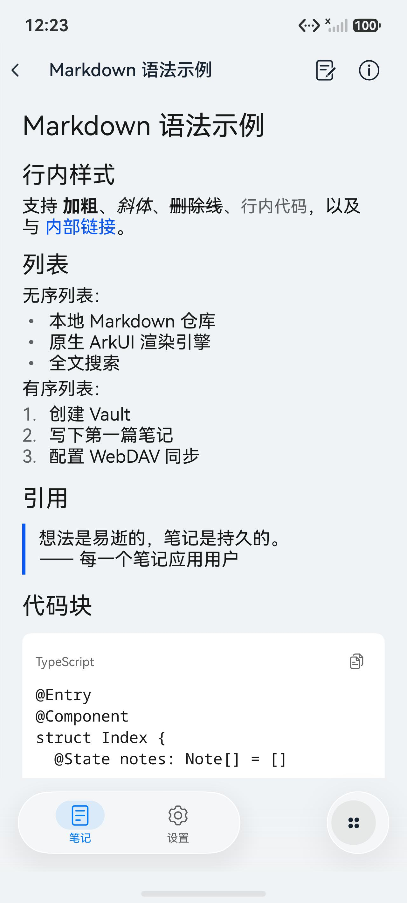
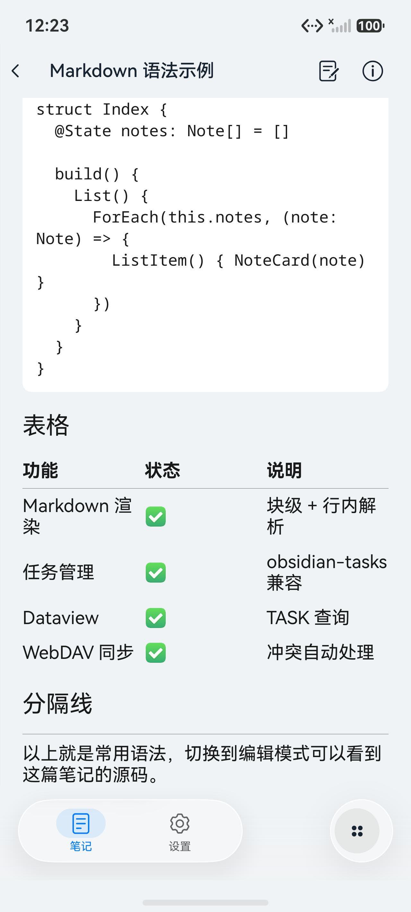
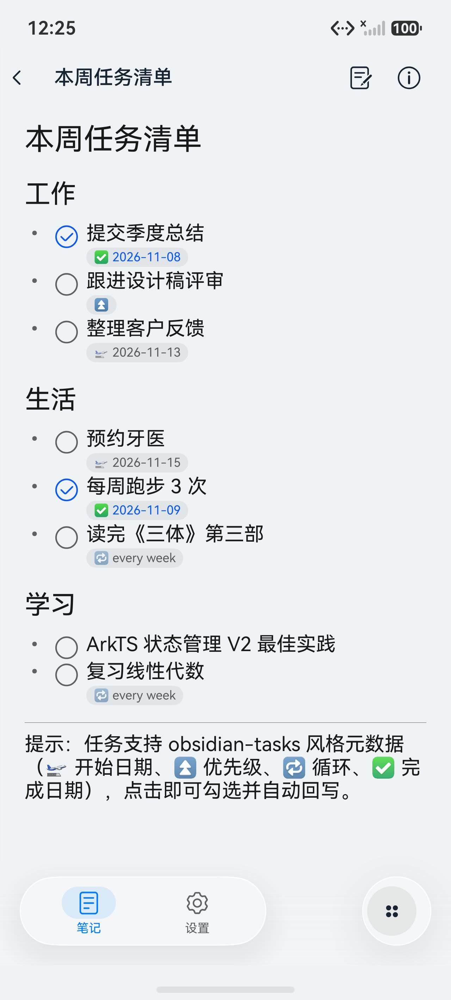
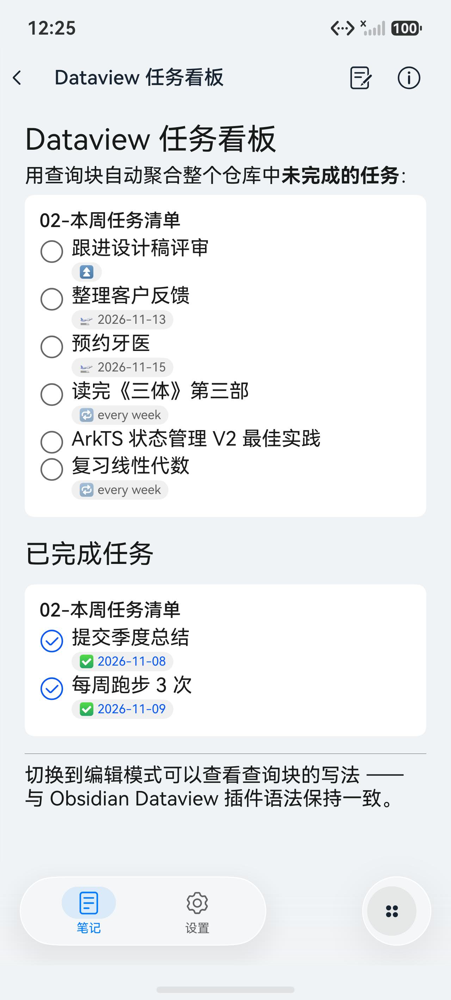
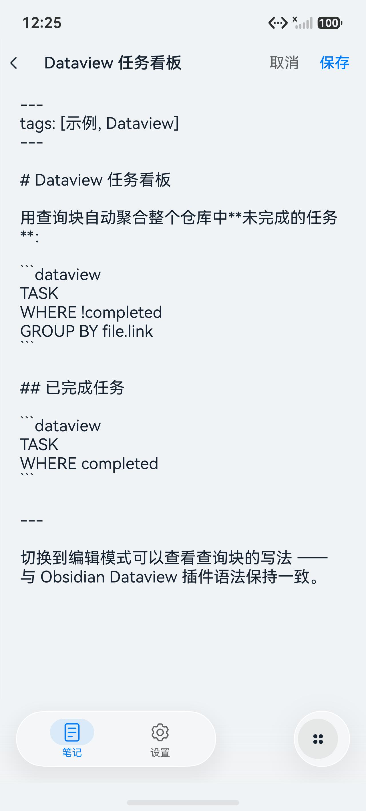
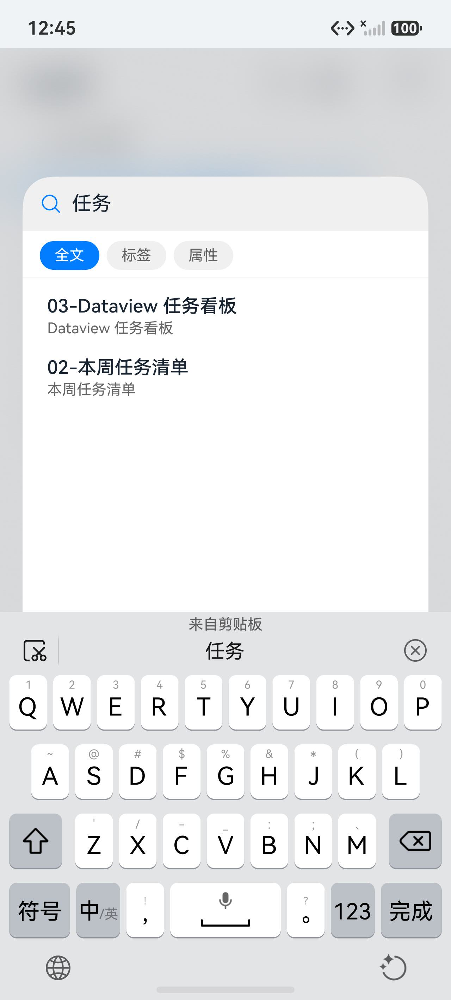
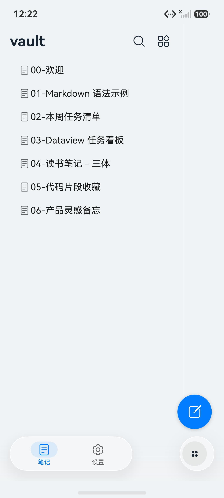

# MySidian — HarmonyOS 本地优先 Markdown 双链笔记应用

类 Obsidian 的鸿蒙原生（HarmonyOS NEXT / API 24+）本地优先知识库与双链笔记应用：自研 ArkTS Markdown 解析与原生渲染引擎、Material 3 单页架构（温润拿铁浅色 / 浓缩咖啡深色双主题）、双链与关系图谱、obsidian-tasks 兼容任务管理、RDB 加速的 Live Dataview 查询块、硬件级加密 WebDAV 多端同步、全文 FTS5 BM25 检索、定时本地快照备份，以及针对手机、折叠屏、平板与 2in1 设备的全场景响应式体验。

## 基本信息

| 项 | 值 |
|---|---|
| 当前版本 | `v0.6.0`（`versionCode: 1000008`） |
| 包名 | `com.mrs.mysidian` |
| 主 Ability | `DefaultAbility`（含桌面长按快捷方式、服务卡片 `FormExtensionAbility`、系统分享 `ShareExtensionAbility`） |
| targetSdkVersion | 26.0.0（compatible 6.1.1 / API 24） |
| 构建系统 | hvigor（DevEco Studio / `devecocli`） |
| 语言与状态管理 | ArkTS（严格模式），主工程全量 `@ComponentV2` + `@ObservedV2` / `@Trace` |

## 应用展示

<p align="center">
  
  
  
</p>
<p align="center">
  
  
  
</p>
<p align="center">
  
</p>

## 模块结构

```text
AppScope/                  应用级配置与版本信息（v0.6.0）
common/                    HAR：公共常量、EmptyState、FileTreeView、BreakpointSystem、Logger、
                           SecretStore（@kit.AssetStoreKit 硬件级凭据加密）
features/
  domain/                  HAR：纯领域模型层（MdModel / VaultModel / SyncModel）+ SyncProvider 接口
  markdown/                HAR：自研 Markdown 引擎
    parser/                BlockParser / InlineParser / FrontmatterParser / FrontmatterSerializer /
                           MarkdownParser / TaskMetadata（obsidian-tasks 兼容）/
                           DataViewQuery（TASK / TABLE / LIST + WHERE / SORT / LIMIT 解析）/
                           TemplateEngine / LinkRewriter
    render/                MdDocumentView / MdBlockView / MdInlineText / MdInlineFlattener /
                           CodeHighlighter（原生多语言语法着色）/ MathRenderer / MermaidFlow /
                           MdWebFallback（ArkWeb 复杂 HTML 兜底）
  vault/                   HAR：本地存储与索引层
    db/                    RDB DAO（Schema v4）：Note / Block / Link / Prop / Search(FTS5) /
                           Tag / Vault / SyncState
    manager/               VaultManager（含本地快照自动备份与恢复）/ VaultPath / ZipTransfer /
                           NoteResolver / AttachmentResolver / FileHistory / FuzzyMatcher
    indexer/               IndexPipeline（增量块/双链/标签/属性/列表项索引）/ Tokenizer
  sync/                    HAR：WebDAV 同步引擎
    SyncEngine（SHA-256 基线 + mtime/size 哈希缓存 + 冲突决策）/ ConflictResolver /
    SyncFileFilter / WebDavProvider
products/default/          主工程（entry）
  pages/DesignIndex.ets    唯一 @Entry：Material 3 单页架构（文件 / 搜索 / 图谱 / 更多 四页签 +
                           悬浮分离式胶囊底栏 + 页内全屏 WorkspaceView 切换）
  view/design/             WorkspaceView / EditorPane / FindReplaceBar / TreeItemMenuSheet /
                           ImagePreviewOverlay / NoteInfoSheet / CalendarSheet / TemplateSheet /
                           HistorySheet / TrashSheet / HandwriteSheet / QuickNoteSheet /
                           CommandPalette / QuickSwitcher / SearchOverlay / SettingsSheet /
                           SyncSettingsSheet / VaultManagerSheet / DialogHost / OnboardView /
                           CompletionPopup / EditorToolbar
  view/                    NoteInfoPanel（大纲/反链/标签/属性/局部图谱五页签）/ GraphView
  viewmodel/               VaultViewModel / SearchViewModel / SyncViewModel / GraphLayout /
                           DesignPalette / DesignTokens / FindReplaceUtils / AppCommand
```

依赖方向：`default → markdown / vault / sync / domain / common`；`markdown / vault / sync → domain / common`；禁止反向依赖。

## 核心特性（截至 v0.6.0）

### 1. Material 3 单页架构与深浅双主题
- **单页零路由切换**：`DesignIndex` 作为唯一 `@Entry`，通过页内状态机在「四页签首页（文件 / 搜索 / 图谱 / 更多）」与「全屏工作台（`WorkspaceView`）」间丝滑切换，配备弹簧曲线胶囊底栏与 FAB 快捷闪念气泡菜单。
- **温润拿铁 / 浓缩咖啡双色板**：全量采用语义化 `design_*` 与 `md_*` 资源令牌（`DesignTokens`），支持**跟随系统 / 浅色 / 深色**三档应用内实时切换。
- **全场景响应式布局**：手机（`<600vp` 抽屉侧栏 + 键盘智能避让）、折叠屏（`600–900vp` 固定文件树 + 右缘悬浮信息面板）、平板/2in1（`≥900vp` 三栏并排 + 分屏双开对照阅读）。

### 2. 原生 Markdown 渲染与代码块语法高亮
- **全语法原生渲染**：标题、列表、任务、引用、折叠 Callout（`> [!NOTE]-`）、宽表格横向滚动、`==高亮==`、图片块（`![[x.png|300]]`）、笔记章节嵌入（`![[笔记#章节]]`）、Unicode 数学公式（`MathRenderer`）与原生 Canvas 流程图（`MermaidFlow`）。
- **原生代码块语法着色（v0.6.0）**：内置线性词法分析器 `CodeHighlighter`，支持 ArkTS / TypeScript / JavaScript / Python / Java / Go / Rust / C / SQL 等语言的关键字、类型、字符串、数字与注释深浅色自适应高亮。
- **图片全屏预览（v0.5.0）**：点击笔记内图片打开 `ImagePreviewOverlay`，支持双指 1x–5x 捏合缩放、拖拽平移与双击放大复位。

### 3. 编辑器生产力与文件树管理
- **源码编辑与格式工具栏**：17 项快捷语法按钮（支持横向滚动与焦点保持）、`[[` 双链自动补全（前缀优先 + 包含匹配，不存在时点按自动建笔记）、`#` 标签自动补全、列表/任务回车自动续行、50 步防抖撤销/重做栈。
- **页内查找与替换（v0.5.0）**：编辑态顶栏一键呼出 `FindReplaceBar`，支持大小写不敏感匹配计数、上下跳转高亮选中、单次替换与全部替换（自动入撤销栈）。
- **文件树与书签置顶（v0.5.0 / v0.6.0）**：支持新建文件夹、点击标题或节点菜单（`TreeItemMenuSheet`）重命名（全库自动重写 `[[旧名]]`、`[[旧名|别名]]`、`[[旧名#标题]]` 引用）、移动、移入/恢复回收站（`.trash`）、文件历史快照（`.history` LCS 行级 Diff 与一键回滚）；支持 **`★ 书签` 置顶**（编辑器顶栏、文件树菜单、工作台侧栏与首页文件页四处联动）。

### 4. 双链知识网络、RDB 加速 Dataview 与全文检索
- **全库与局部关系图谱**：首页全库 Canvas 力导向图谱与笔记信息面板 1–2 跳局部图谱，支持双指捏合缩放（1x–16x）、单指平移、按节点度数分级披露标签与邻接簇高亮。
- **反链与未链接提及 RDB 化**：信息面板展示大纲、反向链接、未链接提及（基于 `BlockDao.findMentions` RDB 检索并支持一键转为 `[[双链]]`）、交互式 Frontmatter 属性编辑器（支持新增/删除属性与布尔/列表/日期/文本写回）。
- **Live Dataview 查询引擎（v0.6.0 RDB 加速）**：支持 `TASK`、`TABLE`、`LIST` 查询及 `FROM #tag`、`WHERE`（含日期比较算子）、`SORT`、`LIMIT`；通过 `TagDao.tagsByVault`、`PropDao.propsByVault`、`BlockDao.listBlocksByPaths` 实现 RDB 批量求值，任务勾选支持跨笔记实时回写。
- **FTS5 全文检索**：支持全文 / 标签 / 属性三模式搜索，具备 FTS5 索引启动自愈、`bm25(note_fts, 10.0, 1.0)` 标题高权重相关性排序及三段式命中高亮摘要。

### 5. WebDAV 安全同步与本地快照备份
- **硬件级凭据加密（v0.5.0）**：基于 `@kit.AssetStoreKit`（`SecretStore`）加密存储 WebDAV 密码，自动迁移并清除旧版 `preferences` 明文密码；支持自定义 CA 证书导入与跳过证书校验风险提示。
- **DB v4 哈希缓存与冲突处理中心（v0.5.0）**：`sync_state` 记录文件 `mtime` 与 `size`，未改动文件免重算 SHA-256；发生双端冲突时可在「同步冲突处理中心」内联查看 LCS 行级差异，一键选择「保留本地」或「采用远端」（自动备份本地快照）。
- **定期与一键本地快照备份（v0.6.0）**：打开仓库时每 24 小时自动在沙箱 `<filesDir>/backups/` 生成 zip 快照（自动轮转保留最近 5 份），并在「设置 → 本地快照备份」支持随时手动创建快照或一键恢复任意历史快照。

### 6. 鸿蒙原生多端特性（v0.6.0）
- **2in1 / 平板物理键盘快捷键**：`Ctrl+S` 保存草稿、`Ctrl+E` 切换编辑/阅读、`Ctrl+F` 页内查找替换、`Ctrl+N` 新建笔记、`Ctrl+P` 命令面板、`Ctrl+O` 快速切换笔记。
- **桌面长按快捷方式（App Shortcuts）**：长按桌面图标直达「新建闪念」「今日日记」「全局搜索」（支持冷/热启动）。
- **手写速记、系统分享与桌面卡片**：内置 Canvas 手写速记自动转 PNG 附件插入笔记；支持从第三方应用分享 Markdown 文本直接入库；提供桌面服务卡片。

## 构建与运行

```powershell
# 构建签名与未签名 HAP
devecocli build

# 编译单元测试（Markdown / DataView / Template / SyncEngine / FindReplace / CodeHighlighter）
$env:DEVECO_SDK_HOME = "C:\Program Files\Huawei\DevEco Studio\sdk"
node "C:\Program Files\Huawei\DevEco Studio\tools\hvigor\bin\hvigorw.js" --mode module -p module=default@default default@UnitTestArkTS

# 安装到模拟器或真机
hdc install -r products/default/build/default/outputs/default/default-default-signed.hap
```

详细设计决策与里程碑记录见 [`doc/DEVELOPMENT.md`](doc/DEVELOPMENT.md)；AI 协作规范见 [`AGENTS.md`](AGENTS.md)。
