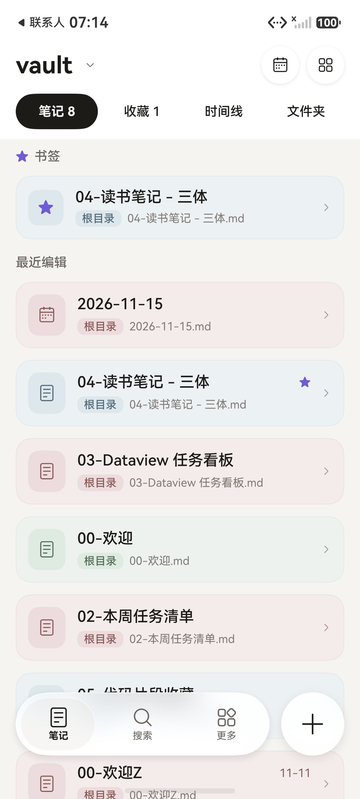
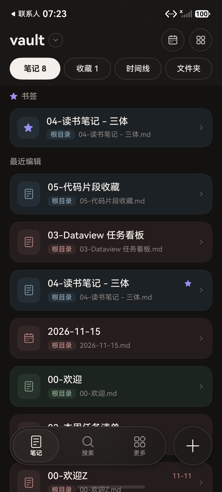
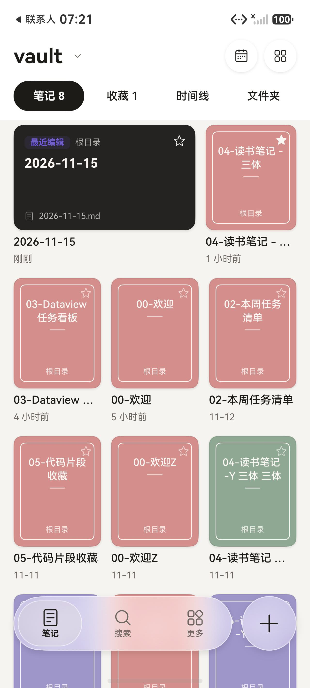
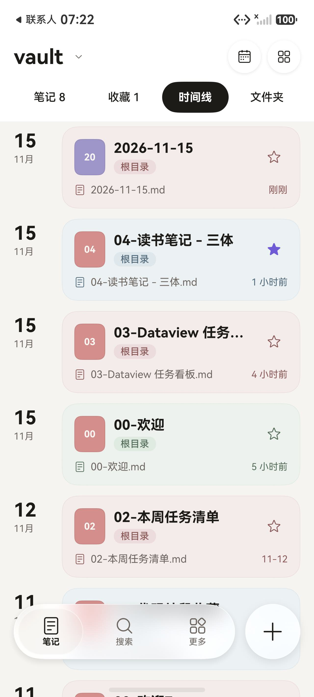
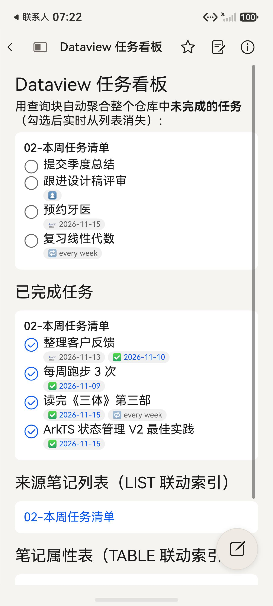
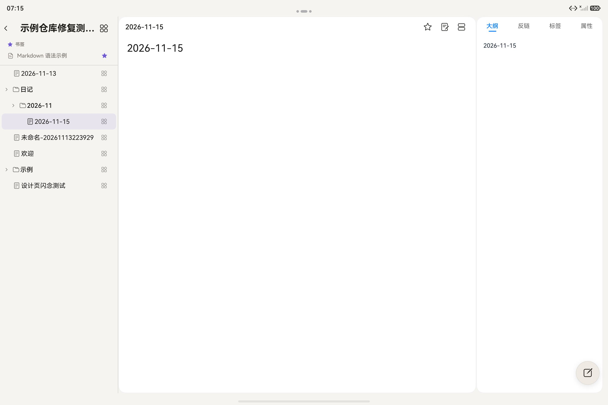
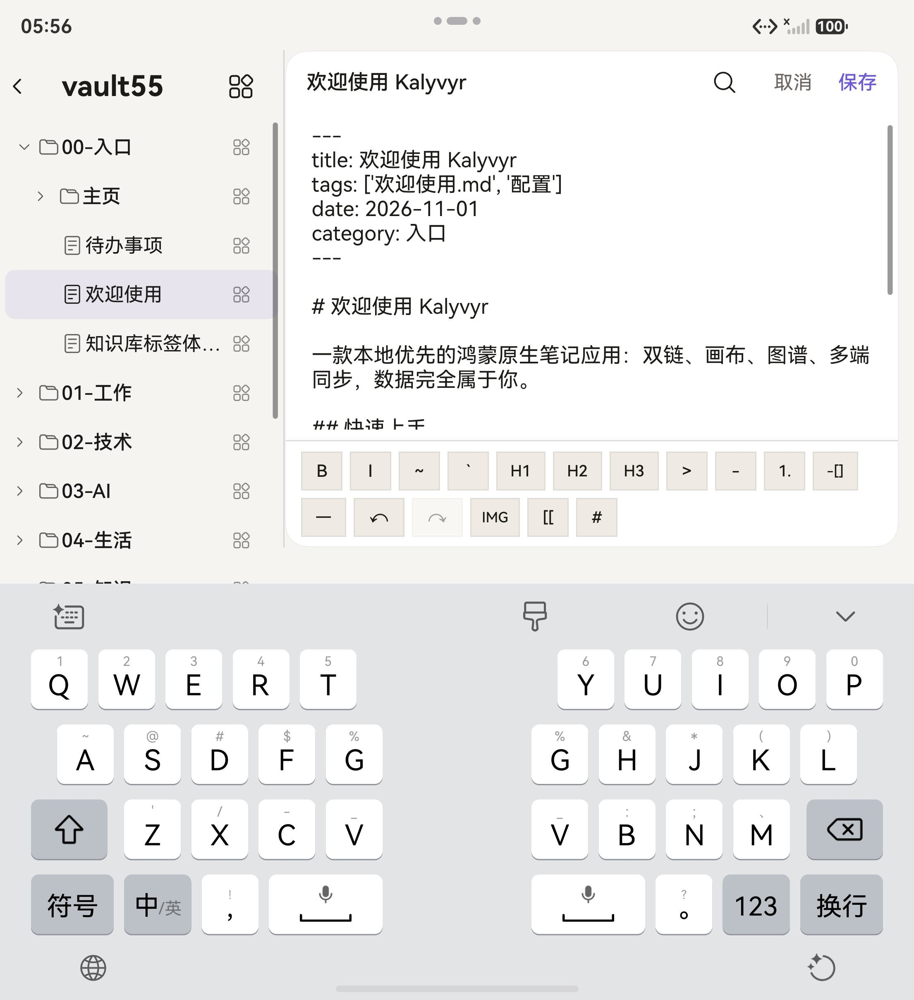
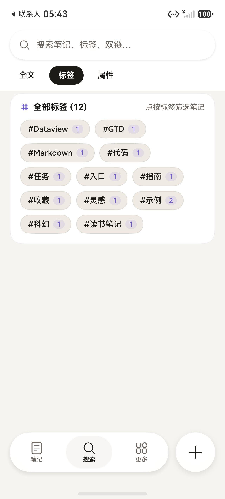
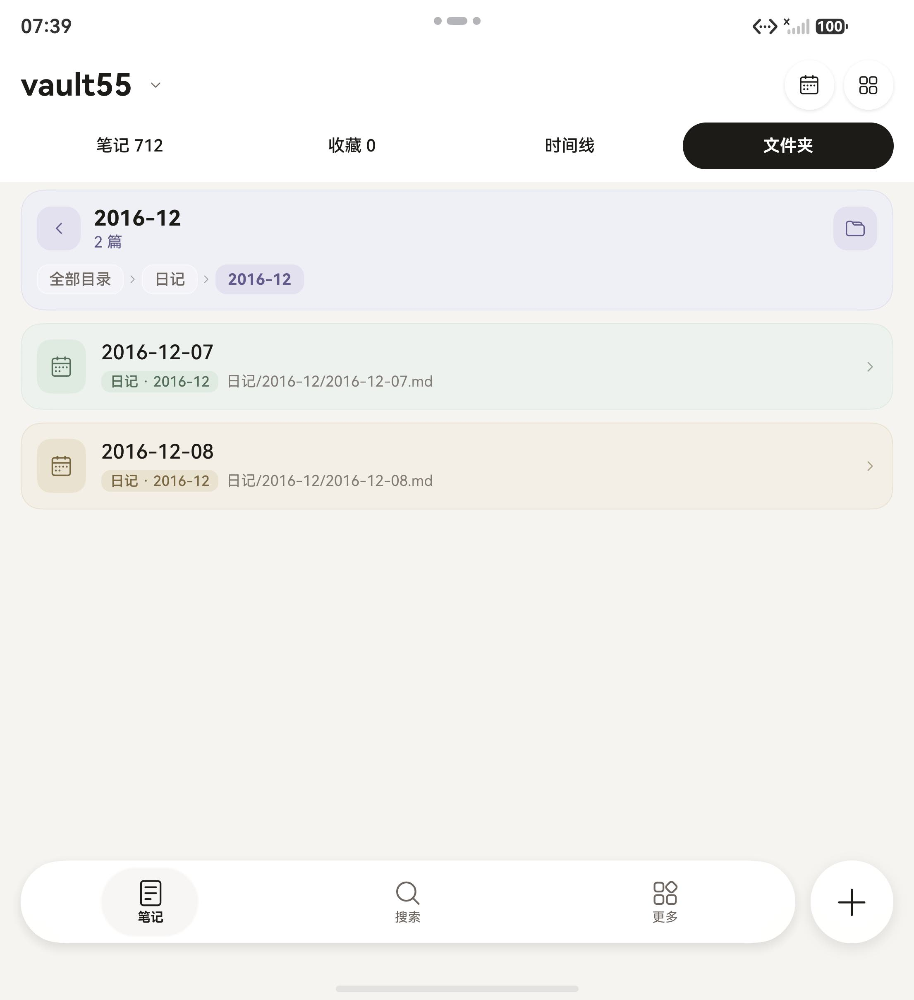

<div align="center">


# MySidian

**HarmonyOS NEXT 原生 · 本地优先 · 双链 Markdown 知识库应用**

[](AppScope/app.json5)
[-262321?style=flat-square)](#构建与运行)
[](#技术架构与模块结构)
[](#五webdav-安全同步与本地快照备份)

类 Obsidian 的鸿蒙原生本地优先（Local-First）知识库笔记应用。<br/>
自研 ArkTS 原生 Markdown 渲染引擎 · 素雅柔彩莫兰迪 UI · 毫秒级 RDB / FTS5 索引 · WebDAV 硬件级加密同步 · 全场景多端自适应。

[界面预览](#界面预览) · [核心特性](#核心特性) · [全场景自适应](#全场景设备形态适配) · [架构设计](#技术架构与模块结构) · [构建与运行](#构建与运行)

</div>

---

## 基本信息

| 项目 | 说明 |
|---|---|
| **发布版本** | `v1.0.0`（`versionCode: 1000100`） |
| **应用包名** | `com.mrs.mysidian` |
| **入口与扩展能力** | `DefaultAbility`、桌面服务卡片（`FormExtensionAbility`）、系统文本分享（`ShareExtensionAbility`）、备份恢复（`DefaultBackupAbility`） |
| **适配设备形态** | 手机（Phone）、折叠屏 / 阔直屏（Foldable）、平板（Tablet）与 PC / 2in1 键盘操作 |
| **系统与构建工具** | HarmonyOS API 24+（`targetSdkVersion 26.0.0` / `compatible 6.1.1`），`hvigor` / `devecocli` |
| **状态与主题体系** | 严格模式 ArkTS，`@ComponentV2` + `@ObservedV2` / `@Trace` + `@Computed`；浅色 / 深色 / 跟随系统实时切换 |

---

## 界面预览

### 1. 首页默认「素雅柔彩列表」与多元浏览视图（浅 / 深双主题）

> 打开应用默认呈现素雅低饱和莫兰迪纸色卡片列表（浅色温润纸底 / 深色炭灰护眼），搭配悬浮分离式毛玻璃胶囊底栏；可随时一键切换 **书架封面宫格** 与 **时间线流**。

<table>
  <tr>
    <td align="center" width="25%">
      <br/>
      <sub><b>默认列表视图（浅色）</b><br/>低饱和柔彩纸面 · 日记/文件夹区分</sub>
    </td>
    <td align="center" width="25%">
      <br/>
      <sub><b>默认列表视图（深色）</b><br/>护眼炭灰底色 · 莫兰迪暗调适配</sub>
    </td>
    <td align="center" width="25%">
      <br/>
      <sub><b>书架封面宫格</b><br/>2:1 精选大卡 + 莫兰迪三列便签</sub>
    </td>
    <td align="center" width="25%">
      <br/>
      <sub><b>时间线流</b><br/>真实日期字牌 · 底部实时毛玻璃模糊</sub>
    </td>
  </tr>
</table>

### 2. 原生 Markdown 渲染、代码高亮与 Live Dataview 看板

> 常用 Markdown 语法均由纯 ArkTS 渲染引擎直接绘制（零 WebView 开销），支持双向链接跳转、可交互任务清单、多语言代码块着色与 RDB 加速的实时 Dataview 查询。

<p align="center">
  
  &nbsp;&nbsp;
  
  &nbsp;&nbsp;
  
</p>
<p align="center">
  <sub>左：原生引用、列表与 <code>[[双链]]</code> 渲染 &nbsp;|&nbsp; 中：ArkTS / PowerShell 等多语言语法高亮与复制 &nbsp;|&nbsp; 右：<code>TASK / LIST / TABLE</code> 实时查询与勾选写回</sub>
</p>

### 3. 全场景多端自适应 & 按年月分卷日记目录

> 根据窗口宽度与宽高比智能切换阅读编辑空间：手机与阔直屏专注正文不误弹大纲，平板展现经典三栏并排；日记默认自动组织为 <code>日记/YYYY-MM/YYYY-MM-DD.md</code>。

<table>
  <tr>
    <td align="center" width="38%">
      <br/>
      <sub><b>平板三栏工作台</b><br/>左侧嵌套目录树 <code>日记 &gt; 2026-11 &gt; 2026-11-15</code> + 中栏正文 + 右侧大纲</sub>
    </td>
    <td align="center" width="34%">
      <br/>
      <sub><b>平板默认首页列表</b><br/>顶部目录卡片 + <code>日记 · 2026-11</code> 胶囊路径标签</sub>
    </td>
    <td align="center" width="28%">
      <br/>
      <sub><b>折叠屏 / 阔直屏双栏编辑</b><br/>左树右编，多行工具栏一目了然</sub>
    </td>
  </tr>
</table>

### 4. 多行标签瀑布流、原地目录穿透与单层「更多」中枢

<p align="center">
  
  &nbsp;&nbsp;
  
  &nbsp;&nbsp;
  
</p>
<p align="center">
  <sub>左：搜索页 <code>#标签</code> 自动换行瀑布平铺与数量徽章 &nbsp;|&nbsp; 中：首页原地目录穿透（<code>全部目录 › 日记 › 2016-12</code> 面包屑 · 列表/宫格切换） &nbsp;|&nbsp; 右：四联统计概览 + 单层「笔记工具 / 设置与数据管理」</sub>
</p>

---

## 核心特性

### 一、Material 3 视觉与流畅单页架构
- **素雅柔彩列表与原地目录穿透**：首页「笔记」默认展示文件夹与近期笔记的 5 色低饱和莫兰迪纸感卡片；点击任意文件夹直接在当前统一风格内**逐级穿透目录**，顶部呈现可点击祖先面包屑（`全部目录 › 父目录 › 当前目录`），列表/三列宫格自由切换，仅在明确点选笔记时进入正文工作台（系统返回键逐级回退）。
- **全新分层品牌视觉与流畅单页架构**：采用 `Ceramic Washi & Prism Fold` 鸿蒙分层应用图标（`$media:layered_image`）及浅/深双主题冷启动页；`DesignIndex` 作为唯一 `@Entry`，在首页三页签（`笔记` / `搜索` / `更多`）与全屏工作台 `WorkspaceView` 之间以弹性动效无缝过渡；底部悬浮分离式毛玻璃胶囊底栏 + 右侧独立 FAB，支持一键呼出「今日日记 / 闪念速记 / 模板新建 / 新建笔记」。
- **深浅双色语义化令牌**：全面基于 `design_*`、`design_tint_*` 与 `md_*` 资源颜色，支持应用内实时切换**跟随系统 / 浅色 / 深色**。

### 二、自研原生 ArkTS Markdown 引擎
- **全语法原生渲染**：支持多级标题、有序/无序列表、任务列表（阅读态直接勾选并回写源文件）、引用与可折叠 Callout（`> [!NOTE]-`）、宽表格横向滚动、`==高亮==`、带宽度图片（`![[pic.png|300]]`）、笔记章节嵌入（`![[笔记#章节]]`）、Unicode 数学公式（`MathRenderer`）与原生 Canvas 流程图（`MermaidFlow`）；复杂 HTML 由 `MdWebFallback` 安全兜底。
- **多语言代码块词法着色**：内置线性词法分析器 `CodeHighlighter`，支持 ArkTS / TypeScript / JavaScript / Python / Java / Go / Rust / C / SQL 等语言高亮，深浅色自适应并支持一键复制。
- **全屏图片手势预览**：`ImagePreviewOverlay` 支持 1x–5x 双指捏合缩放、拖拽平移与双击复位。

### 三、标准分卷日记、高效编辑与文件树
- **按年月分卷的日记工作流**：
  - 点击顶部「今日日记」、FAB「日记」、日历弹窗（`CalendarSheet`）或桌面快捷方式时，默认创建并打开 **`日记/YYYY-MM/YYYY-MM-DD.md`**（例如 `日记/2026-11/2026-11-15.md`），自动匹配日记模板并定位 `{{cursor}}`。
  - 兼容读取历史根目录 `YYYY-MM-DD.md` 日记，快速闪念追加（`appendQuickNote`）与桌面服务卡片均遵循相同路径优先级。
- **面向移动端与物理键盘的写作体验**：
  - 17 项常用语法（加粗、斜体、删除线、代码、H1–H3、引用、列表、待办、分割线、撤销、重做、图片、`[[`、`#` 等）采用多行自适应平铺工具栏，浅/深模式下高对比清晰显示。
  - 输入 `[[` 触发全库双链模糊匹配补全（选择不存在的标题时自动建档），输入 `#` 触发标签补全；列表/待办回车自动续行；50 步防抖撤销与重做；内置 `FindReplaceBar` 支持页内大小写不敏感匹配计数、跳转与逐项/全部替换。
- **全链路文件树与版本安全**：
  - 支持多级目录创建、移动与重命名（`LinkRewriter` 自动重写全库 `[[旧名]]`、`[[旧名|别名]]`、`[[旧名#小节]]`）。
  - 删除默认进入 `.trash` 回收站（可一键恢复或清空），重要修改自动留存 `.history` 快照支持 LCS 行级 Diff 对比与一键回滚。
  - 支持 **`★ 书签` 置顶**，编辑器、侧栏文件树、首页列表与书签页签四处实时联动。

### 四、RDB v4 索引、Dataview 查询与全文检索
- **Live Dataview 实时查询**：原生支持 `TASK`、`TABLE`、`LIST` 与 `FROM #tag`、`WHERE`（含日期比较）、`SORT`、`LIMIT` 子句，结合 `TagDao` / `PropDao` / `BlockDao` 在 RDB 层批量求值，看板勾选任务直接写回源笔记。
- **FTS5 中文分词全文检索**：基于 `Tokenizer` 中文 bigram 分词与 `bm25(note_fts, 10.0, 1.0)` 标题加权排序，支持启动 FTS5 索引自愈与命中高亮三段式摘要；搜索提供**全文 / 标签（多行平铺）/ 属性**三模式，并内置页内 `SearchOverlay` 快速跳查与 `QuickSwitcher`（`Ctrl+O`）秒开笔记。
- **四维文档信息面板（`NoteInfoPanel`）**：集成**大纲跳转**、**反向链接与未链接提及（支持一键转为 `[[双链]]`）**、**标签聚合**与**交互式 Frontmatter 属性表单**（文本 / 布尔开关 / 日期 / 列表直改写回；知识图谱 `GraphView` 模块已保留解耦以备按需启用，默认不在主界面占位）。

### 五、WebDAV 安全同步与本地快照备份
- **硬件级凭据加密与证书开关**：基于 HarmonyOS `@kit.AssetStoreKit`（`SecretStore`）安全存取 WebDAV 账号密码，支持自定义 CA 证书导入，以及在「新建仓库」/「同步设置」独立开启自签名 HTTPS 跳过证书校验开关。
- **干跑安全闸门与无感增量同步**：同步采用先干跑规划后执行、零差异/纯拉取静默放行、逐文件断点基线落盘与 `WebDAV MOVE` 至 `.trash/` 软删除策略，杜绝误删与中途失败重复全量扫描；`sync_state` 持久化 `mtime` 与 `size`，未修改文件免重算哈希；双端冲突可在冲突中心直接审阅 LCS 行级 Diff，自由选择「保留本地」或「采用远端」。
- **自动与手动 zip 快照备份**：打开仓库每 24 小时自动在沙箱生成 zip 快照（轮转保留最近 5 份），并可在「更多 → 备份与维护」随时手动备份或一键恢复任意历史快照，也可导出整个仓库 zip 在桌面 Obsidian 直接打开。

### 六、全场景多端生态融合
- **物理键盘快捷键（平板 / 2in1）**：`Ctrl+S` 保存、`Ctrl+E` 切换编辑/阅读、`Ctrl+F` 页内查找替换、`Ctrl+N` 新建笔记、`Ctrl+P` 命令面板、`Ctrl+O` 快速切换笔记。
- **系统「打开方式」预览与生态集成**：支持从系统文件管理器或第三方应用通过「打开方式」直接唤醒 MySidian（冷/热启动）只读浏览外部 `.md` / `.markdown` 文件、查看大纲与标签并一键导入当前库或新建仓库导入；内置 Canvas 手写画板自动转存 PNG 插入笔记，支持桌面长按快捷方式、桌面服务卡片以及系统分享面板 URI/文本导入。

---

## 全场景设备形态适配

| 设备形态 | 宽度断点 | 默认布局策略 | 信息面板（大纲/反链/标签/属性）行为 |
|---|---|---|---|
| **手机 Phone** | `< 600vp` | 单栏沉浸正文 + 左侧滑出文件树抽屉 | 默认收起，点击右上角 `(i)` 弹出浮层；切换笔记、右滑或点击遮罩自动关闭 |
| **折叠屏 / 阔直屏** | `600vp ~ 899vp` | 左侧可折叠目录树 + 右侧宽屏正文双栏并排 | **不自动弹出**，点击 `(i)` 以右侧浮层呼出，绝不挤压编辑与阅读视野 |
| **平板 / 2in1 PC** | `>= 900vp` | 经典三栏并排（目录树 + 正文 + 信息面板） | 大屏常驻右侧三栏（可手动收起），支持物理键盘快捷键与对照阅读 |

---

## 技术架构与模块结构

系统采用清晰的分层模块化设计，严格约束单向依赖方向：

```text
products/default (UI · ViewModel · 能力扩展)
   ├──▶ features/markdown (原生解析 · 排版渲染 · 代码着色 · Math · Mermaid)
   ├──▶ features/vault    (RDB v4 Schema · FTS5 · 文件存储 · 历史 · 模板 · 压缩备份)
   ├──▶ features/sync     (WebDAV 协议 · 增量同步引擎 · 冲突决策)
   └──▶ features/domain · common (领域模型 · AssetStoreKit 凭据 · 响应式断点 · 工具)
```

> 依赖纪律：`default → markdown / vault / sync / domain / common`；`markdown / vault / sync → domain / common`；禁止反向依赖或循环依赖。

<details>
<summary><b>展开查看完整工程目录树</b></summary>

```text
AppScope/                         应用级配置与版本信息（v1.0.0, versionCode: 1000100）
common/                           HAR：通用基础组件与系统能力封装
  constants/                      公共常量（CommonConstants）
  ui/                             EmptyState、FileTreeView、FileTreeDataSource
  utils/                          BreakpointSystem、Logger、SecretStore（@kit.AssetStoreKit）
features/
  domain/                         HAR：纯领域模型与服务契约
    model/                        MdModel、VaultModel、SyncModel
    service/                      SyncProvider、SyncFileFilter
  markdown/                       HAR：自研原生 Markdown 引擎
    parser/                       BlockParser / InlineParser / FrontmatterParser /
                                  FrontmatterSerializer / MarkdownParser / TaskMetadata / DataViewQuery
    render/                       MdDocumentView / MdBlockView / MdInlineText / MdInlineFlattener /
                                  CodeHighlighter / MathRenderer / MermaidFlow / MdMermaidView / MdWebFallback
  vault/                          HAR：本地知识库存储与 RDB/FTS5 索引
    db/                           DbHelper (Schema v4)、VaultDao、NoteDao、BlockDao、
                                  LinkDao、TagDao、PropDao、SearchDao (FTS5)、SyncStateDao
    manager/                      VaultManager、VaultPath (含日记年月路径解析)、TemplateEngine、
                                  LinkRewriter、AttachmentResolver、NoteResolver、FileHistory、
                                  FuzzyMatcher、ZipTransfer、DemoVaultContent
    indexer/                      IndexPipeline、Tokenizer（中文 bigram + 前缀匹配）
  sync/                           HAR：WebDAV 同步引擎
    engine/                       SyncEngine（基线对比 + mtime/size 缓存）、ConflictResolver
    provider/                     WebDavProvider（PROPFIND / GET / PUT / DELETE / MKCOL / CA 支持）
products/default/                 主工程入口（entry）
  pages/DesignIndex.ets           唯一 @Entry：三页签毛玻璃主页、FAB 气泡与全屏工作台切换
  form/                           桌面服务卡片 FormExtensionAbility & FormCard
  share/                          系统分享接收 ShareExtensionAbility
  view/design/                    WorkspaceView、EditorPane、EditorToolbar、FindReplaceBar、
                                  NoteInfoSheet、TreeItemMenuSheet、ImagePreviewOverlay、CalendarSheet、
                                  TemplateSheet、HistorySheet、TrashSheet、HandwriteSheet、QuickNoteSheet、
                                  CommandPalette、QuickSwitcher、SearchOverlay、SettingsSheet、
                                  SyncSettingsSheet、VaultManagerSheet、DialogHost、OnboardView、CompletionPopup
  view/                           NoteInfoPanel（大纲/反链/标签/属性四页签，可选局部图谱）、GraphView
  viewmodel/                      VaultViewModel、SearchViewModel、SyncViewModel、
                                  DesignTokens、DesignPalette、EditorTextUtils、FindReplaceUtils、AppCommand、GraphLayout
```

</details>

---

## 构建与运行

### 环境要求
- **DevEco Studio**（HarmonyOS SDK 26.0.0 / API 24+）与 **`devecocli`**
- 已配置签名证书（`build-profile.json5`）或本地 HarmonyOS 模拟器 / 真机

### 常用命令

```powershell
# 1. 全量构建签名与未签名 HAP
devecocli build

# 2. 运行全模块单元测试（common / markdown / vault / default）
& "C:\Program Files\Huawei\DevEco Studio\tools\node\node.exe" `
  "C:\Program Files\Huawei\DevEco Studio\tools\hvigor\bin\hvigorw.js" `
  test --mode module -p "module=common@default,markdown@default,vault@default,default@default"

# 3. 静态代码规范检查（Code Linter）与 Release 模式打包
devecocli check lint
devecocli build --build-mode release

# 4. 安装到真机或模拟器并启动
hdc install -r products/default/build/default/outputs/default/default-default-signed.hap
hdc shell aa start -a DefaultAbility -b com.mrs.mysidian
```

---

## 版本演进

| 版本 | 核心里程碑 |
|---|---|
| **`v1.0.0`** | **全端质感打磨与 1.0 正式发布**：全新分层品牌图标与浅/深冷启动页、首页默认素雅莫兰迪纸色列表与双主题 5 色柔彩体系、文件夹原地逐级穿透与面包屑导航、悬浮毛玻璃三页签底栏与顶栏快捷入口、标准 `日记/YYYY-MM/YYYY-MM-DD.md` 按年月分卷目录、手机/折叠屏/平板大纲自适应、多行编辑工具栏与标签瀑布流、WebDAV 无感安全同步（断点落盘/安全闸门/自签名证书独立开关）、系统 `.md`「打开方式」只读预览与一键导入，以及全模块单测通过。 |
| **`v0.6.0`** | 查询引擎（Dataview / 日历）RDB 批量加速、列表项入库、`CodeHighlighter` 原生多语言代码高亮、`★ 书签` 全链路置顶、定时与手动 zip 快照备份恢复、2in1 键盘快捷键与桌面长按快捷方式。 |
| **`v0.5.0`** | `SecretStore` 硬件级凭据加密、DB v4 `sync_state` 哈希缓存与同步冲突中心、FTS5 + BM25 中文相关性搜索、RDB 未链接提及、编辑态页内查找替换与 1x–5x 图片缩放预览。 |
| **`v0.4.0`** | 单页 Material 3 架构重构、自研 Markdown 解析与渲染引擎、WebDAV 增量同步、RDB 索引管线、`NoteInfoPanel` 与文件树全操作集成。 |

---

## 相关文档

- 架构决策与阶段变更详录：[`doc/DEVELOPMENT.md`](doc/DEVELOPMENT.md)
- 工程规范与协作约定：[`AGENTS.md`](AGENTS.md)
