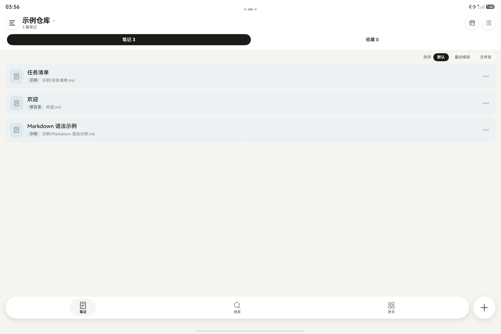
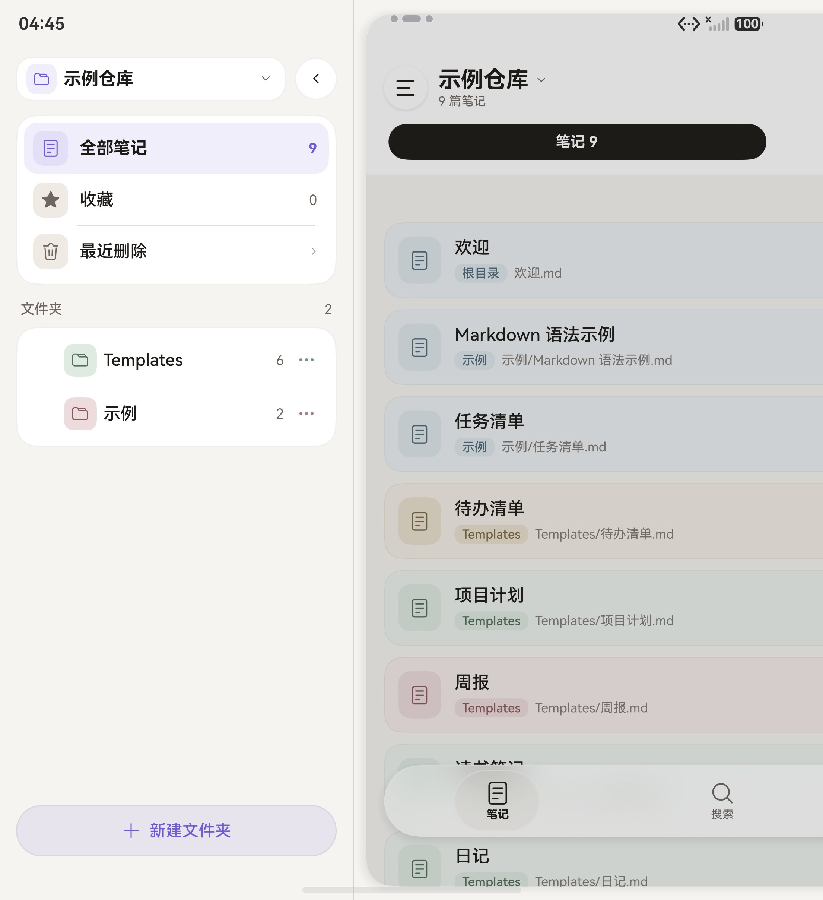
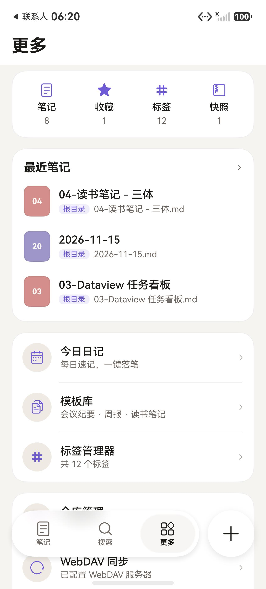
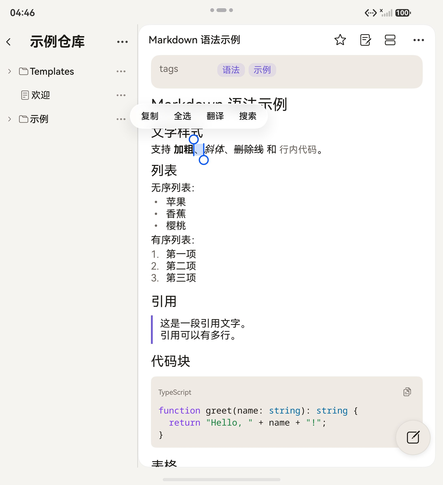
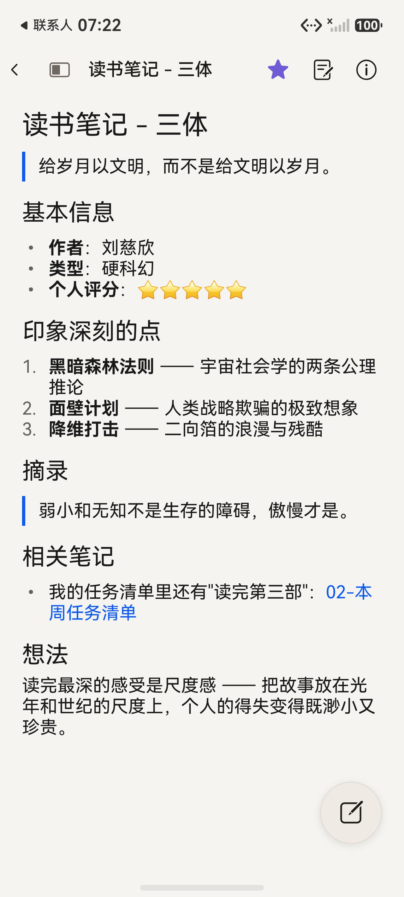
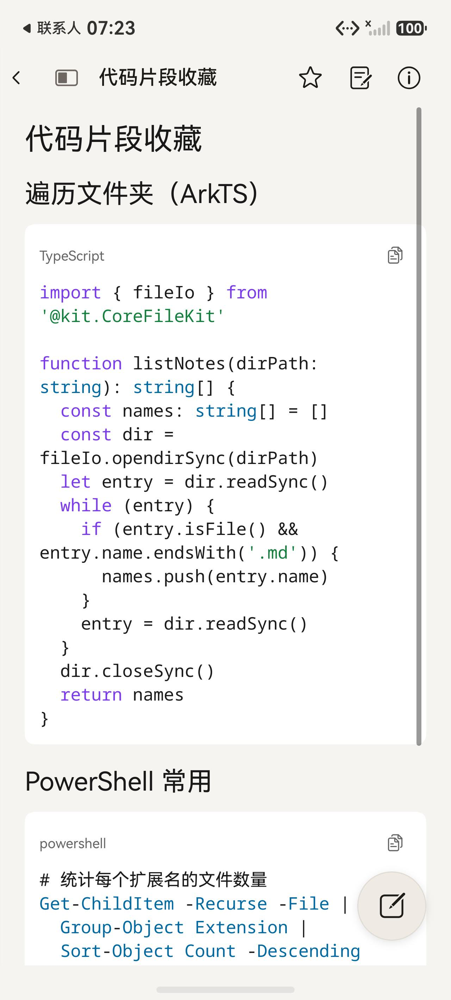
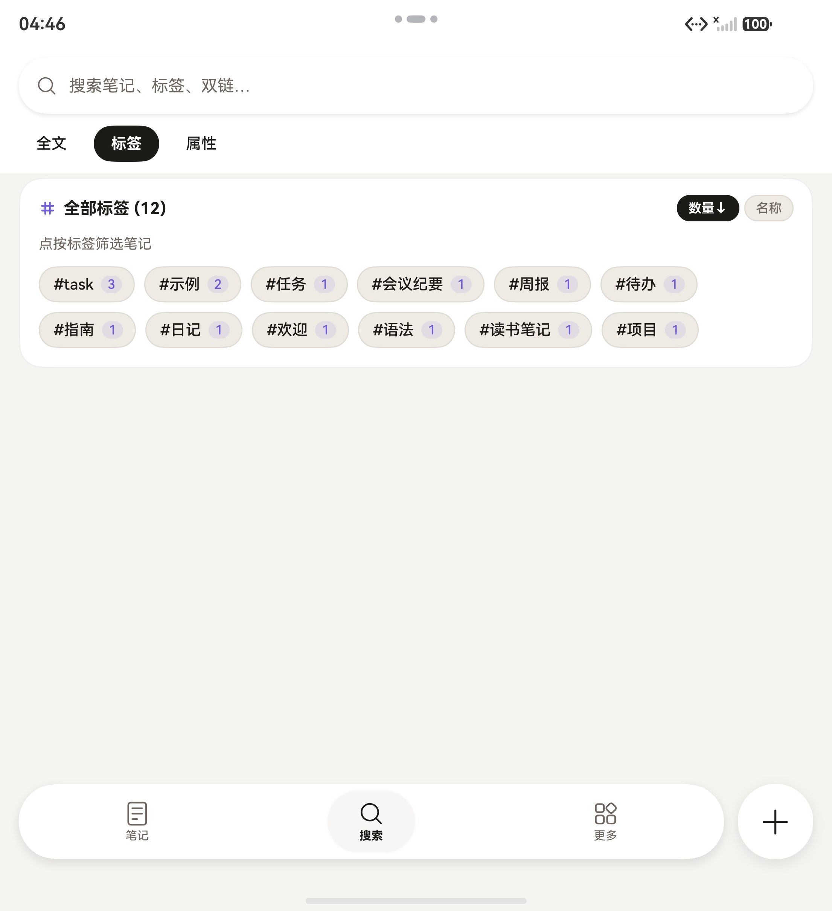

<div align="center">


# MySidian

**HarmonyOS NEXT 原生 · 本地优先 · 双链 Markdown 知识库应用**

[](AppScope/app.json5)
[-262321?style=flat-square)](#构建与运行)
[](#技术架构与模块结构)
[](#五webdav-安全同步与本地快照备份)

类 Obsidian 的鸿蒙原生本地优先（Local-First）知识库笔记应用。<br/>
自研 ArkTS 原生 Markdown 渲染引擎 · 素雅柔彩莫兰迪 UI · 毫秒级 RDB / FTS5 索引 · WebDAV 硬件级加密同步 · 全场景多端自适应。

[界面预览](#界面预览) · [核心特性](#核心特性) · [全场景自适应](#全场景设备形态适配) · [架构设计](#技术架构与模块结构) · [构建与运行](#构建与运行)

</div>

> [!IMPORTANT]
> **本项目已移交，不再维护。** 后续维护与更新请移步新仓库：**[lindos-ohdev/onionnote](https://github.com/lindos-ohdev/onionnote)**。
>
> 由于新项目更改了应用包名，本仓库的笔记数据迁移到新项目需要 **先导出，再导入**。
>
> 如果你是通过 **WebDAV** 同步笔记的，则无需手动迁移：在新应用中新建仓库时配置好 WebDAV，数据会自动同步回来。

---

## 基本信息

| 项目 | 说明 |
|---|---|
| **发布版本** | `v1.5.0`（`versionCode: 1000700`） |
| **应用包名** | `com.mrs.mysidian` |
| **入口与扩展能力** | `DefaultAbility`、桌面服务卡片（`FormExtensionAbility`）、系统文本分享与「打开方式」（`ShareExtensionAbility` / `skills`）、备份恢复（`DefaultBackupAbility`） |
| **适配设备形态** | 手机（Phone）、折叠屏 / 阔直屏（Foldable）、平板（Tablet）与 PC / 2in1 键盘操作 |
| **系统与构建工具** | HarmonyOS API 24+（`targetSdkVersion 26.0.0` / `compatible 6.1.1`），`hvigor` / `devecocli` |
| **状态与主题体系** | 严格模式 ArkTS，`@ComponentV2` + `@ObservedV2` / `@Trace` + `@Computed`；浅色 / 深色 / 跟随系统实时切换 |

---

## 界面预览

### 1. 极简首页、左滑出文件夹抽屉与多元浏览视图（浅 / 深双主题）

> 首页精简为 **「笔记 | 收藏」** 双子页签与悬浮毛玻璃胶囊底栏；点按左上角 `≡` 或向右滑动手势可平滑推开主列表露出左侧文件夹抽屉，顶栏按钮可在 **列表 ↔ 时间线 ↔ 宫格** 三种视图间一键切换。

<table>
  <tr>
    <td align="center" width="38%">
      <br/>
      <sub><b>极简首页（笔记 | 收藏）</b><br/>莫兰迪柔彩卡片 · <code>默认 / 最近修改 / 文件名</code> 排序</sub>
    </td>
    <td align="center" width="32%">
      <br/>
      <sub><b>左侧滑出文件夹抽屉</b><br/>全部笔记 / 收藏 / 最近删除 / 多级目录树</sub>
    </td>
    <td align="center" width="30%">
      <br/>
      <sub><b>深色护眼主题</b><br/>莫兰迪暗调语义化令牌实时切换</sub>
    </td>
  </tr>
</table>

<table>
  <tr>
    <td align="center" width="33%">
      <br/>
      <sub><b>书架封面宫格</b><br/>2:1 精选大卡 + 莫兰迪三列便签</sub>
    </td>
    <td align="center" width="33%">
      <br/>
      <sub><b>时间线流</b><br/>按真实日期字牌流式回顾</sub>
    </td>
    <td align="center" width="34%">
      <br/>
      <sub><b>功能中枢与统计概览</b><br/>笔记 / 收藏 / 标签 / 快照与设置入口</sub>
    </td>
  </tr>
</table>

### 2. 原生 Markdown 渲染、阅读态长按选中复制与 Frontmatter 属性卡

> 纯 ArkTS 原生渲染引擎（零 WebView 开销），正文顶部支持 YAML Frontmatter 属性胶囊卡；**非编辑阅读态**下长按正文任意片段即可选中文字并唤起系统 `复制 / 全选` 菜单与可拖动手柄，同时不影响 `[[双链]]`、外链与 `#标签` 点击跳转。

<table>
  <tr>
    <td align="center" width="36%">
      <br/>
      <sub><b>阅读态属性卡 &amp; 长按选词复制</b><br/>YAML 属性胶囊 + 原生选择手柄与 <code>复制 / 全选</code></sub>
    </td>
    <td align="center" width="21%">
      <br/>
      <sub><b>原生富文本排版</b><br/>引用 / 列表 / <code>[[双链]]</code></sub>
    </td>
    <td align="center" width="21%">
      <br/>
      <sub><b>多语言代码块高亮</b><br/>一键复制 · 深浅自适应</sub>
    </td>
    <td align="center" width="22%">
      <br/>
      <sub><b>Live Dataview 看板</b><br/><code>TASK / LIST / TABLE</code> 写回</sub>
    </td>
  </tr>
</table>

### 3. 全场景多端自适应、多行编辑工具栏 & 按数量排序的标签检视

> 按窗口断点智能自适应排布（手机单栏沉浸、折叠屏双栏、平板三栏）；搜索页 `#标签` 默认按**关联笔记数量从多到少**排列，并可一键切换按名称检索。

<table>
  <tr>
    <td align="center" width="36%">
      <br/>
      <sub><b>平板三栏工作台</b><br/>左树（<code>日记/YYYY-MM</code>）+ 正文 + 右侧四维大纲</sub>
    </td>
    <td align="center" width="32%">
      <br/>
      <sub><b>折叠屏 / 阔直屏双栏编辑</b><br/>左目录树 + 右侧专注编辑与格式工具栏</sub>
    </td>
    <td align="center" width="32%">
      <br/>
      <sub><b>按数量降序的标签广场</b><br/>支持 <code>数量↓ / 名称</code> 切换 · 点按标签直达筛选</sub>
    </td>
  </tr>
</table>

---

## 核心特性

### 一、Material 3 视觉、左抽屉与联动横滑体验
- **左侧滑出文件夹抽屉与单层净简主页**：
  - 首页「笔记」顶部精简为 **`笔记 | 收藏`** 双子页签，移除列表顶部的折叠目录与重复收藏堆叠，完整呈现库内笔记；卡片继续保留长按与右侧 `⋯` 高级操作菜单，顶栏视图按钮可在 **列表 / 时间线 / 宫格** 三视图间实时切换。
  - 点击左上角 `≡` 按钮或使用右拉手势（避让系统侧滑返回区），即可带阻尼遮罩平滑推开主视图露出左侧文件夹抽屉，聚合 `全部笔记`、`收藏`、`最近删除`（直达回收站）、多级可展开/收起文件夹目录树与 `+ 新建文件夹`。
- **顶栏子页签与底栏主标签联动横滑**：
  - 采用嵌套 `Swiper`（`SELF_FIRST` 联动），在底部处于 `笔记` 时自右向左滑动会先依次划过 `笔记 → 收藏` 顶部子页签，抵达末项后再继续横滑平滑切换至底栏第二项 `搜索`（以及 `更多`），反向滑动同样逐级回溯。
- **全新分层品牌视觉与主题令牌**：
  - 采用 `Ceramic Washi & Prism Fold` 鸿蒙分层应用图标（`$media:layered_image`）与浅/深双主题冷启动页；全面基于 `design_*`、`design_tint_*` 与 `md_*` 资源色值，支持应用内实时切换**跟随系统 / 浅色 / 深色**。

### 二、自研原生 ArkTS Markdown 引擎与阅读交互
- **非编辑阅读态自由选词与复制**：
  - 正文、标题、引用、Callout、列表、代码块、公式、图片说明与属性卡均启用 `CopyOptions.LocalDevice`，长按即可选择文本并弹出系统 `复制 / 全选` 菜单；存在选区期间自动抑制外层侧滑手势，与 `[[双链]]`、外链、`#标签` 独立点击互不干扰。
- **阅读态 YAML Frontmatter 属性卡**：
  - 在正文顶部以圆角卡片渲染 YAML frontmatter 属性，`tags` / `tag` 以可点击胶囊芯片展示并支持一键跳转标签检索，列表值与嵌套结构清晰呈现，大纲定位按属性卡占位自动校准滚动偏移。
- **全语法原生渲染 & 多语言高亮**：
  - 纯 ArkTS 原生绘制（零 WebView 开销），支持多级标题、任务列表（勾选直接回写源文件）、可折叠 Callout（`> [!NOTE]-`）、宽表格横向滚动、`==高亮==`、带宽度图片（`![[pic.png|300]]`）、笔记章节嵌入（`![[笔记#章节]]`）、Unicode 数学公式（`MathRenderer`）与原生 Canvas 流程图（`MermaidFlow`）；复杂 HTML 由 `MdWebFallback` 安全兜底。
  - `CodeHighlighter` 支持 ArkTS / TypeScript / JavaScript / Python / Java / Go / Rust / C / SQL 等词法着色与一键复制；`ImagePreviewOverlay` 支持全屏 1x–5x 双指捏合缩放、平移与双击复位。

### 三、纯原生所见即所得写作、可视化表格与全链路文件管理
- **零 WebView 原生 ArkUI 所见即所得（WYSIWYG）与双模式无缝切换**：
  - 基于单面 `RichEditor` 打造原生所写即所得体验（120Hz 原生顺滑滚动与系统中文 IME / 长按选择菜单），同时保留**「所见 ↔ 源码」**与**纯阅读模式**；切换「所见 ↔ 源码」时由 `WysiwygCodec` 自动映射并保持光标停留在同一词/段落附近。
  - 实时渲染分级标题、粗体/斜体/删除线/`==高亮==`/行内代码、代码块语法着色与语言标签条、左槽列表符号/复选框/引用竖线（`WysiwygMarginCache`）及可编辑 YAML Frontmatter 属性卡（`WysiwygPropertiesCard`）。
- **原生 `OffscreenCanvas` 表格渲染与弹窗网格编辑**：
  - 所见模式下 Markdown 表格直接渲染为适配深浅主题与屏幕宽度的圆角表格卡片（保留对齐方式与行内格式）；点击表格即可唤起 **`WysiwygTableSheet`**，直接修改表头/单元格、增删行列、逐列切换左/中/右对齐或切换「源码微调」双工编辑；输入 `| 表头 |\n| --- |` 回车自动生成表格，全程纳入 `↶ / ↷` 50 步防抖撤销重做。
- **新建直达编辑与分卷日记**：
  - 首页 FAB 短按直接新建并进入编辑态；工作台 FAB 语义统一为进入当前笔记编辑态（`Ctrl+E`）。
  - 点击「今日日记」、日历弹窗（`CalendarSheet`）或桌面快捷方式时，自动在 **`日记/YYYY-MM/YYYY-MM-DD.md`** 创建/打开日记并套用模板定位 `{{cursor}}`（兼容根目录历史日记文件）。
- **内置 6 个常用模板与三维度排序**：
  - 内置**日记、周报、会议纪要、读书笔记、项目计划、待办清单**模板并在新建示例仓库时自动播种，支持 `{{title}}`、`{{date}}`、`{{date:FMT}}`、`{{time}}`、`{{week}}`、`{{cursor}}` 占位符。
  - 首页「笔记」与「收藏」统一支持 **默认 / 最近修改 / 文件名** 胶囊排序切换；「更多」页精简为工具与设置两层并新增「关于」页展示开源与版本信息。
- **全类型附件管理、目录可视化与快捷插入**：
  - `VaultManager` 自动识别并优先复用仓库中已有的 `attachments` / `attachment` 目录；工具栏除 `图片`（相册图片）外新增 **`附件`** 选择器，可一键导入 PDF、DOCX/XLSX/PPTX、音视频等文件并保留原文件名自动插入 `[[文件名]]`（图片插入 `![[文件名]]`）。
  - 左侧抽屉目录角标同步统计非 Markdown 附件数量；点进目录可直接看到图片缩略图（点选 `ImagePreviewOverlay` 全屏缩放预览）及 PDF/DOCX 卡片；在笔记正文中点击附件双链可直接预览或调用系统默认应用查看，不再误建 `.md`。
- **移动端与物理键盘写作文流**：
  - 底部命令化格式工具栏（参考 obsidian-editing-toolbar）：行内/标题/块级/历史/插入五分组，标题单键循环 H1→H4，撤销重做真实禁用态，溢出右缘渐隐提示，固定「收起键盘」按钮，全条目无障碍朗读；即时高亮当前选区/光标格式，源码模式同样支持选区包裹/解包；输入 `[[` 自动补全 `]]` 并触发全库双链补全面板（支持 `Tab` / 空白点击自动收尾），输入 `#` 触发标签补全；无序、有序列表（`1. → 2. → 3.`）与待办回车自动续行递增；内置 `FindReplaceBar` 支持页内查找、计数跳转与逐项/全部替换。
  - 重命名或移动笔记时由 `LinkRewriter` 自动重写全库 `[[旧名]]` / `|别名` / `#锚点`；删除进入 `.trash` 回收站；重要修改留存 `.history` 快照并支持 LCS 行级 Diff 回滚；支持 `★ 书签` 全链路置顶。

### 四、RDB v7 索引、Obsidian 规范标签与全文检索
- **Obsidian 规范标签体系（`TagRules` + RDB v7）**：
  - 单源统一标签校验：支持 ASCII 字母数字、`_-/`（含 `#to_do` 下划线与 `#项目/进行中` 多级嵌套）与 CJK 文字，自动拒绝纯数字（`#2026`）、十六进制色值（`#1A1A2E`）与全角标点误报。
  - 索引统一小写归一与大小写不敏感匹配；搜索输入支持 **`tag:#x`** 包含、**`-tag:#x`** 排除与 **`OR`** 逻辑组合检索（`SearchTextParser`）。
- **固定五行横向懒加载标签广场**：
  - 搜索页 `#标签` 列表采用固定 5 行高度（`212vp`）横向滑动 `Grid` + `Repeat virtualScroll` 懒加载，默认按**关联笔记数量从多到少**排列（同数按字母序），右上角支持 `[ 数量↓ | 名称 ]` 一键切换，选中标签后下方筛选结果立即可见。
- **FTS5 中文分词与 Live Dataview**：
  - 基于 `Tokenizer` 中文 bigram 分词与 `bm25` 标题加权排序，支持启动索引自愈与命中摘要高亮；内置 `SearchOverlay` 与 `QuickSwitcher`（`Ctrl+O`）。
  - Live Dataview 原生支持 `TASK` / `TABLE` / `LIST`（`FROM #tag`、`WHERE`、`SORT`、`LIMIT`）实时求值与勾选写回。
- **四维文档信息面板（`NoteInfoPanel`）**：
  - 集成**大纲跳转**、**反向链接与未链接提及（支持一键转双链）**、**标签聚合**与**交互式 Frontmatter 属性表单**。

### 五、WebDAV 安全同步与本地快照备份
- **硬件级凭据加密与证书开关**：
  - 基于 HarmonyOS `@kit.AssetStoreKit`（`SecretStore`）加密存储 WebDAV 凭据，支持自定义 CA 证书导入及在「新建仓库」/「同步设置」独立开启自签名 HTTPS 跳过证书校验开关。
- **全类型知识库附件双向同步与防误删保护**：
  - 通过 `SyncFileFilter` 统一管理双向同步范围：除 Markdown 笔记与图片外，全面支持 **PDF、Office 文档（`docx/doc/xlsx/xls/pptx/ppt`）、文本数据（`txt/csv/tsv/rtf/odt/epub`）、音视频（`mp3/m4a/wav/ogg/aac/flac/mp4/mov/webm`）与白板文件（`excalidraw/canvas`）** 经 WebDAV 二进制通道双向同步，同时严密拦截 `.zip`/`.tmp`/`.db` 与 `.obsidian/`/`.trash/`/`.mysidian/`/`.git/`。
  - 采用干跑安全闸门、逐文件断点基线落盘、`mtime + size` 哈希缓存、`WebDAV MOVE` 至 `.trash/` 软删（兼容异常 502 自动降级处理），以及 `HEAD` 二次探测与本地 `TRASH_LOCAL` 决策，防止跨设备删除后同步自动恢复；0 字节空笔记不误判 401 冷却；双端冲突提供 LCS 行级 Diff 审阅。
- **定时与手动 zip 快照备份**：
  - 打开仓库每 24 小时自动留存沙箱 zip 快照（保留最近 5 份），支持在设置中一键备份、恢复或导出完整桌面 Obsidian 兼容 zip。

### 六、全场景多端生态融合
- **物理键盘快捷键（平板 / 2in1）**：`Ctrl+S` 保存、`Ctrl+E` 切换编辑/阅读、`Ctrl+F` 页内查找替换、`Ctrl+N` 新建笔记、`Ctrl+P` 命令面板、`Ctrl+O` 快速切换笔记。
- **系统「打开方式」预览与生态集成**：支持从系统文件管理器或第三方应用通过「打开方式」直接唤醒 MySidian（冷/热启动）只读预览外部 `.md` / `.markdown` 文件并一键导入当前库或新建仓库；内置 Canvas 手写画板、桌面长按快捷方式、桌面服务卡片（`FormExtensionAbility`）与系统分享面板接收（`ShareExtensionAbility`）。

---

## 全场景设备形态适配

| 设备形态 | 宽度断点 | 默认布局策略 | 信息面板（大纲/反链/标签/属性）行为 |
|---|---|---|---|
| **手机 Phone** | `< 600vp` | 单栏沉浸列表（左滑出抽屉）+ 单栏工作台 | 默认收起，点击右上角 `(i)` 弹出浮层；切换笔记、右滑或点击遮罩自动关闭 |
| **折叠屏 / 阔直屏** | `600vp ~ 899vp` | 左侧可折叠目录树 + 右侧宽屏正文双栏并排 | **不自动弹出**，点击 `(i)` 以右侧浮层呼出，绝不挤压编辑与阅读视野 |
| **平板 / 2in1 PC** | `>= 900vp` | 经典三栏并排（目录树 + 正文 + 信息面板） | 大屏常驻右侧三栏（可手动收起），支持物理键盘快捷键与对照阅读 |

---

## 技术架构与模块结构

系统采用清晰的分层模块化设计，严格约束单向依赖方向：

```text
products/default (UI · ViewModel · 能力扩展)
   ├──▶ features/markdown (原生解析 · 排版渲染 · 代码着色 · Math · Mermaid)
   ├──▶ features/vault    (RDB v7 Schema · FTS5 · 文件存储 · 历史 · 模板 · 压缩备份)
   ├──▶ features/sync     (WebDAV 协议 · 增量同步引擎 · 冲突决策)
   └──▶ features/domain · common (领域模型 · AssetStoreKit 凭据 · 响应式断点 · 工具)
```

> 依赖纪律：`default → markdown / vault / sync / domain / common`；`markdown / vault / sync → domain / common`；禁止反向依赖或循环依赖。

<details>
<summary><b>展开查看完整工程目录树</b></summary>

```text
AppScope/                         应用级配置与版本信息（v1.5.0, versionCode: 1000700）
common/                           HAR：通用基础组件与系统能力封装
  constants/                      公共常量（CommonConstants）
  ui/                             EmptyState、FileTreeView、FileTreeDataSource
  utils/                          BreakpointSystem、Logger、SecretStore（@kit.AssetStoreKit）
features/
  domain/                         HAR：纯领域模型与服务契约
    model/                        MdModel、VaultModel、SyncModel
    service/                      SyncProvider、SyncFileFilter
  markdown/                       HAR：自研原生 Markdown 引擎
    editor/                       WysiwygModel / WysiwygCodec / WysiwygTableCodec / WysiwygTriggers
    parser/                       BlockParser / InlineParser / FrontmatterParser /
                                  FrontmatterSerializer / MarkdownParser / SearchTextParser /
                                  TagRules / TaskMetadata / DataViewQuery
    render/                       MdDocumentView / MdBlockView / MdPropertiesView / MdInlineText /
                                  MdInlineFlattener / CodeHighlighter / MathRenderer /
                                  MermaidFlow / MdMermaidView / MdWebFallback
  vault/                          HAR：本地知识库存储与 RDB/FTS5 索引
    db/                           DbHelper (Schema v7)、VaultDao、NoteDao、BlockDao、
                                  LinkDao、TagDao、PropDao、SearchDao (FTS5)、SyncStateDao
    manager/                      VaultManager、VaultPath (含日记年月路径解析)、TemplateEngine、
                                  LinkRewriter、AttachmentResolver、NoteResolver、FileHistory、
                                  FuzzyMatcher、ZipTransfer、DemoVaultContent
    indexer/                      IndexPipeline、Tokenizer（中文 bigram + 前缀匹配）
  sync/                           HAR：WebDAV 同步引擎
    engine/                       SyncEngine（基线对比 + mtime/size 缓存）、ConflictResolver
    provider/                     WebDavProvider（PROPFIND / GET / PUT / MOVE / DELETE / MKCOL / CA 支持）
products/default/                 主工程入口（entry）
  pages/DesignIndex.ets           唯一 @Entry：左抽屉文件夹导航、嵌套联动 Swiper、毛玻璃底栏与全屏工作台
  form/                           桌面服务卡片 FormExtensionAbility & FormCard
  share/                          系统分享接收 ShareExtensionAbility
  view/design/                    WorkspaceView、EditorPane、WysiwygEditor、WysiwygEditorEngine、
                                  WysiwygTableSheet、WysiwygTableRenderer、WysiwygPropertiesCard、
                                  WysiwygStyleHelper、WysiwygMarginCache、HomeNoteCards、
                                  EditorToolbar、FindReplaceBar、NoteActionHelper、
                                  NoteInfoSheet、TreeItemMenuSheet、ImagePreviewOverlay、CalendarSheet、
                                  TemplateSheet、HistorySheet、TrashSheet、HandwriteSheet、QuickNoteSheet、
                                  CommandPalette、QuickSwitcher、SearchOverlay、SettingsSheet、
                                  SyncSettingsSheet、VaultManagerSheet、DialogHost、OnboardView、CompletionPopup
  view/                           NoteInfoPanel（大纲/反链/标签/属性四页签，可选局部图谱）、GraphView
  viewmodel/                      VaultViewModel、SearchViewModel、SyncViewModel、
                                  DesignTokens、DesignPalette、EditorTextUtils、FindReplaceUtils、AppCommand、GraphLayout
```

</details>

---

## 构建与运行

### 环境要求
- **DevEco Studio**（HarmonyOS SDK 26.0.0 / API 24+）与 **`devecocli`**
- 已配置签名证书（`build-profile.json5`）或本地 HarmonyOS 模拟器 / 真机

### 常用命令

```powershell
# 1. 全量构建签名与未签名 HAP
devecocli build

# 2. 运行全模块单元测试（common / markdown / vault / default）
& "<DevEco Studio 安装路径>\tools\node\node.exe" `
  "<DevEco Studio 安装路径>\tools\hvigor\bin\hvigorw.js" `
  test --mode module -p "module=common@default,markdown@default,vault@default,default@default"

# 3. 静态代码规范检查（ArkTS）与 Release 模式打包
devecocli check arkts
devecocli build --build-mode release

# 4. 安装到真机或模拟器并启动
hdc install -r products/default/build/default/outputs/default/default-default-signed.hap
hdc shell aa start -a DefaultAbility -b com.mrs.mysidian
```

> Release 分发仅提供未签名包 `mysidian-1.5.0-unsigned.hap`（不分发开发者调试签名证书产物）；如需自行安装，请在 DevEco Studio 中配置个人签名证书重签安装，或直接从源码构建运行。

---

## 版本演进

| 版本 | 核心里程碑 |
|---|---|
| **`v1.5.5`** | **Dataview 勾选冻结行修复与编辑态点标题改名**：修复跨笔记 Dataview TASK 勾选"有的消失、有的卡住、重开文件再点才点动"——`MdBlockView` 任务行 ForEach 键原先用数组下标，乐观移除后剩余任务下标前移与被删行键相同，ArkUI "键相同即复用不重执行 builder"导致复用被删任务的旧行（旧视觉+旧闭包）：勾选行冻结显示、反复点击触发旧对象把已完成任务悄悄翻回未完成并回写源文件；键改为身份+修订号 `dv_${rev}_${path}_${行号}_${checked}`（每次翻转自增 `dataTasksRev`，chips 同步），实测连续勾选非末位行均立即消失、源文件 `[x]`+`✅ 日期` 写入正确；修复新建笔记编辑模式（所见/源码）下点标题不能改名——标题 onClick 原有 `!editMode` guard 且 `renameNote → openNote → applyDocument` 无条件退出编辑态，现去掉 guard 并让 `renameNote`/`moveNote` 捕获 `resumeEdit` 后改用 `openNoteInternal(newPath, false)` 重开（顺带修复改名后旧死路径被压入返回历史、返回键打开不存在笔记的二阶问题）、`startEdit()` 恢复编辑会话（脏草稿改名前已落盘零丢失），实测编辑态点标题改名后仍在编辑态且继续输入正常保存到新名文件。 |
| **`v1.5.4`** | **inline 转义往返重建、孤儿临时文件清理与分享扩展实测收尾**：`WysiwygCodec` 序列化侧新增 `escapePlainRun` 转义协议对偶（无条件转义 `` ` ``/`*`/`$`，`\` 后随标点、`_` 词界、`~`/`=` 成对、`!` 末位防 `![[` 拼接、`#` 标题/标签、行首块级触发），修复 `\*a\*` 等行内转义经所见编辑器往返后反斜杠丢失导致语义漂移（`*a*` 变斜体）；`[`/`!` 特意不转义以保 EMBED/WIKI 片段原文透传；`InlineParser.parseWiki` 修复被转义 `!` 仍触发嵌入检测的潜伏 bug（`isCharEscaped` 前导反斜杠奇偶计数）；`VaultManager` 删除/移动笔记时清理崩溃残留孤儿 `.tmp`（并发互踩窗口经推演证伪为零，真正风险是进程被杀残留）；分享扩展真机级实测：`.md`/`.txt` 文件分享全链路通过（文件管理器 → 系统分享面板 → MySidian 无头落盘 → RDB 登记 → 首页置顶），浏览器 URL 分享正确缺席（类型不匹配）；分享落盘笔记名剥离 `.txt/.text/.log/.html/.org` 等扩展；markdown 单测扩至 80 用例全绿。 |
| **`v1.5.3`** | **全项目对抗性审查修复（六域 40+ 项）**：同步远端超限条目结转不丢清单（`oversizedCarry` + 基线行保留 conflict/serverTag 状态）、`PROPFIND` 响应 multistatus 结构校验；`restoreBackup` 分级回滚保护（stash 搬移中途失败只合并搬回、不清空仓库，回滚失败保留 stash 供人工恢复）；数学块开栏 `$$x = 1` 同行内容保留（解析/序列化两侧修复，含 4 个新增单测断言，全量 75 用例通过）；属性保存以编辑草稿为基准重建 frontmatter、重命名/移动笔记前先落盘脏草稿、保存写盘前快照；所见引擎复扫收编 15 项（查找替换拒绝触及表格/图片原子行占位符、表格编辑先离屏渲染后提交、异步定时器与图片/附件选择器会话守卫、表格位图与 imageMap 缓存修剪、任务勾选命中区按 `WysiwygMarginCache` 真实排版几何推导、源码模式工具栏动作补撤销快照等）；导出 `fd` 泄漏与 `writeSync` 部分写入循环补写修复、`.tmp` 残留清理。 |
| **`v1.5.2`** | **编辑工具栏命令化重构**：参考 obsidian-editing-toolbar 将底部 20 按钮重构为 `TOOLBAR_CHIPS` 命令注册表 + 渐进披露五分组（行内/标题/块级/历史/插入，组间竖分隔线）；标题单键循环 `正文→H1→H2→H3→H4`（所见走引擎 `cycleHeadingOnActiveParagraph`、源码新增 `cycleHeadingAtCaret`）；源码模式行内标记有选区包裹/再点解包、无选区成对插入/toggle 语义对齐（`SourceFormatActions` 纯函数化）；撤销/重做真实禁用态（`.enabled`）与工具栏独立撤销快照（`pushToolbarUndoSnapshot`，不参与输入合并）；内容溢出右缘渐隐提示并修复 `HitTestMode.None` 阻塞下层触摸穿透；新增收起键盘按钮（所见 `stopEditing` / 源码 `clearFocus`）。 |
| **`v1.5.1`** | **坚果云 WebDAV 实战兼容、同步可观测性与弃用 API 清零**：`WebDavProvider` 检测服务端对 `Depth: infinity` 的静默降级（坚果云实测仍返回 207 但只含一级条目，引擎曾误判远端仅剩 5 个文件）——响应含子目录却无嵌套文件时自动回退逐层 BFS 枚举；`SyncEngine` 新增基线哈希回填兜底，清单缺失且服务端 PUT 不返回 ETag（坚果云）时用本地已同步基线的已知哈希回填远端条目 etag（带 serverTag/size 漂移防护），消除每轮数百次逐文件 GET 内容探测打爆限流配额的死锁，实测 773 文件全量同步坚果云成功；拉取落盘后回写远端原始 mtime（临时文件落盘时间不再覆盖历史时间，秒级 mtime 不回写防错设 1970）；后台自动同步失败重试耗尽或不可重试时弹窗提醒（30 分钟冷却去重），出现新的未处理冲突时弹窗提醒并一键跳转同步设置处理，后台同步触发安全暂停同样提醒（此前自动同步会永远静默等待确认）；修复任务列表勾选后复选框不翻转（列表块 rawContent 参与渲染 key 哈希防复用旧节点）；`![[报告.pdf]]` 等文档附件渲染为附件卡片并调用系统查看器打开；清理全部弃用 API（`AlertDialog.show`/`promptAction.showToast`/`router.getParams`/`getStringSync` 弃用重载/`ImagePacker.packing`），构建弃用警告清零。 |
| **`v1.5.0`** | **发布前对抗性审查：同步丢失类缺陷修复与首页热路径性能**：`SyncEngine` 修复 PULL_NEW 拉取文件不落盘基线/清单（manifest 丢条目与删除复活）、TRASH_LOCAL 增加 `targetKey` 守卫防切换同步目标后整批误删本地文件、「保留本地」冲突解决前 stat 比对 ETag 防覆盖远端并发修改，新增 64MB 单文件同步上限与 423 瞬态码；`WYSIWYG` 修复多行粘贴空行数据损坏、撤销/重做表格位图泄漏与按键热路径 $O(n)$ 全篇扫描（行偏移索引 + 二分降至 $O(\log n)$）；首页同步完成后改增量刷新（只重建变化笔记）替代 735 篇全量重建，返回首页同仓库短路跳过全链比对，抽屉目录计数单遍缓存 $O(2{\times}D{\times}F) \to O(1)$ 查表，`syncIndex` 批量块计数 735 次查询归一，标签网格不再随选中态整格销毁重建。 |
| **`v1.4.3`** | **WebDAV 同步防丢失、Markdown 解析往返修正与全库索引 $O(N)$ 优化**：`SyncEngine` 复用规划阶段快照跳过成功轮二次全库 SHA-256 并防止同步途中编辑被误标已同步丢失；`SyncViewModel` 在冲突解决期加锁阻止并发同步覆盖基线；`WebDavProvider` 瞬时故障（401/403/408/429/5xx）抛错重试防止删库跳过、`PROPFIND` 尾斜杠仅在 `207/200` 采纳；`WysiwygCodec` 修复显式空行倍增损坏；`InlineParser` 修复多反引号代码、图片 `alt` 提取与嵌套/词内下划线强调边界；`IndexPipeline` 与 `VaultViewModel` 将整库索引重建优化至 $O(N)$、重命名同步刷新 FTS 标题并在切库/删库时清理返回栈与分屏状态；`WysiwygPropertiesCard` 属性改用 `@Computed` 缓存，清理 `129` 条废弃字符串资源与无用代码。 |
| **`v1.4.2`** | **首页虚拟滚动列表复用重复渲染修复**：将笔记卡片、时间线行、收藏卡片与书架宫格卡片拆分为 `@ComponentV2` 独立子组件（`HomeNoteCards`），配合 `Repeat.virtualScroll` `.templateId` 独立复用池与 `ItemLongPressModifier` 动态路径解析，彻底修复从文件夹抽屉切换「全部笔记」并向下翻页时列表卡在虚拟复用池反复重复前十几条笔记的问题，确保列表、时间线与书架宫格三视图全量滑动均可正确刷新与长按操作。 |
| **`v1.4.1`** | **所见有序列表递增修复与 PDF/DOCX 全类型附件同步预览**：修复所见模式输入 `1. ` 后连续回车编号固定停留在 `1.` 的问题，确保 `1. → 2. → 3.` 递增渲染与准确序列化；`SyncFileFilter` 扩展支持 PDF、DOCX/XLSX/PPTX、音视频与 Canvas/Excalidraw 二进制 WebDAV 双向同步；工具栏新增「附件」选择器并兼容复用 `attachments`/`attachment` 目录，抽屉角标与首页目录视图直接呈现图片缩略图及附件卡片，点击 `[[附件]]` 双链可预览图片或调用系统应用打开文档（不再误建 `.md`）。 |
| **`v1.4.0`** | **纯原生所见即所得编辑器、可视化表格与搜索标签横滑重构**：零 WebView 基于 ArkUI `RichEditor` 打造原生所写即所得 Markdown 编辑体验（保留纯阅读与源码模式），实现 `WysiwygCodec` 无损双向互转与跨模式光标映射、工具栏高亮与中文输入法样式联动、`[[]]` 自动配对补全、可编辑 Frontmatter 属性卡及 50 步差分撤销重做；新增 `OffscreenCanvas` 深浅自适应表格卡片与 `WysiwygTableSheet` 网格/源码双模编辑器；搜索页标签面板重构为固定五行横向懒加载网格。 |
| **`v1.3.0`** | **大仓库懒加载性能优化、交互收敛与「关于」页**：首页列表重构为 `List/Grid + Repeat virtualScroll` 懒加载，735 篇仓库冷启动内存大幅下降；精简「更多」页结构并新增「关于」页；统一工作台与首页新建直达编辑器的 FAB 交互语义。 |
| **`v1.2.0`** | **左抽屉文件夹交互、阅读态选词复制与交互顺滑升级**：非编辑阅读态支持正文/代码块/属性卡长按选择并弹出系统 `复制 / 全选` 菜单（选区期间屏蔽侧滑冲突）；首页重构为左侧可拉出文件夹抽屉（聚合全部笔记/收藏/最近删除/多级目录树与新建文件夹）+ 极简 `笔记 \| 收藏` 双子页签；实现底部主标签与顶部子页签的逐级嵌套联动横滑；搜索页 `#标签` 默认按关联笔记数降序排列并支持 `数量↓ / 名称` 一键切换；顶栏三视图按钮响应同步刷新。 |
| **`v1.1.1`** | **Obsidian 标签规范对齐、属性卡与跨端删除同步修复**：新增 `TagRules` 单源校验（大小写归一/下划线/嵌套层级/剔除色值与纯数字误报）、`tag:/-tag:/OR` 搜索语法与 RDB v7 全量自愈迁移；新增阅读态 YAML Frontmatter 属性胶囊卡、新建笔记直达编辑，以及跨设备删除 `TRASH_LOCAL` 与 0 字节空笔记推送修复。 |
| **`v1.1.0`** | **列表多维排序与内置常用模板**：收藏与文件夹视图支持默认/最近修改/文件名排序切换；内置日记、周报、会议纪要、读书笔记、项目计划、待办清单 6 套模板；优化 WebDAV MOVE 降级与认证冷却机制。 |
| **`v1.0.0`** | **全端质感打磨与 1.0 正式发布**：全新分层品牌图标与浅/深冷启动页、首页素雅莫兰迪纸色列表与双主题 5 色柔彩体系、悬浮毛玻璃底栏、按年月分卷日记（`日记/YYYY-MM/YYYY-MM-DD.md`）、自适应大纲浮层、WebDAV 安全同步与系统 `.md`「打开方式」只读预览。 |
| **`v0.6.0`** | 查询引擎（Dataview / 日历）RDB 批量加速、列表项入库、`CodeHighlighter` 原生多语言代码高亮、`★ 书签` 全链路置顶、定时与一键 zip 快照备份恢复、2in1 键盘快捷键与桌面长按快捷方式。 |
| **`v0.5.0`** | `SecretStore` 硬件级凭据加密、DB v4 `sync_state` 哈希缓存与同步冲突中心、FTS5 + BM25 中文相关性搜索、RDB 未链接提及、编辑态页内查找替换与 1x–5x 图片缩放预览。 |
| **`v0.4.0`** | 单页 Material 3 架构重构、自研 Markdown 解析与渲染引擎、WebDAV 增量同步、RDB 索引管线、`NoteInfoPanel` 与文件树全操作集成。 |

---

## 相关文档

- 架构决策与阶段变更详录：[`doc/DEVELOPMENT.md`](doc/DEVELOPMENT.md)
- 工程规范与协作约定：[`AGENTS.md`](AGENTS.md)
